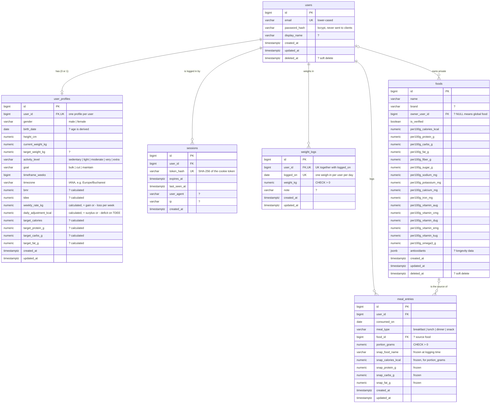

# DietNow – Database (ERD)

PostgreSQL 16. The schema is defined only in Go (`backend/internal/models/`) and created by GORM AutoMigrate (`go run ./cmd/migrate`, or at API startup). There are no SQL scripts.

The diagram below was checked against the live schema that `go run ./cmd/migrate` creates (`information_schema` and `pg_indexes`), not only against the Go structs.

## Diagram

Keys: **PK** primary key, **FK** foreign key, **UK** unique. A `?` in the note means the column may be NULL.

## Relationships

| From | To | Cardinality | Foreign key | When the parent row is deleted |
|---|---|---|---|---|
| users | user_profiles | 1 to 0..1 | `user_profiles.user_id` (unique) | profile deleted (CASCADE) |
| users | sessions | 1 to many | `sessions.user_id` | sessions deleted (CASCADE) |
| users | weight_logs | 1 to many | `weight_logs.user_id` | weigh-ins deleted (CASCADE) |
| users | meal_entries | 1 to many | `meal_entries.user_id` | entries deleted (CASCADE) |
| users | foods | 0..1 to many | `foods.owner_user_id` (nullable) | the user's private foods deleted (CASCADE); global foods have no owner and stay |
| foods | meal_entries | 0..1 to many | `meal_entries.food_id` (nullable) | entries kept, `food_id` set to NULL (SET NULL) |

## Design decisions

**Every user-owned row carries `user_id`.** The repository layer adds `WHERE user_id = <logged-in user>` to every query, so one user can never read or change another user's rows. A request for someone else's row gets 404.

**Global and private foods share one table.** `owner_user_id IS NULL` means a global food everyone can see (the seeded catalog); otherwise the food is private to its owner. One table lets a meal entry point to either kind through a single `food_id`.

**Meal entries freeze their nutrition.** When a portion is logged, the food's name and its nutrition scaled to `portion_grams` are copied into the `snap_*` columns.

Example: 80 g of Rolled Oats (389 kcal / 100 g) is stored with `snap_calories_kcal = 311.2`. If the food is later edited to 400 kcal / 100 g, or deleted, that day's log still says 311.2. The daily totals are sums of the `snap_*` columns, so past days never change.

**Calendar days are `date`, not timestamps.** `consumed_on` and `logged_on` have no time and no time zone.

Example: a user in Bucharest logs breakfast at 01:00 on 6 November. Stored as a UTC timestamp it would be 23:00 on 5 November, and the entry would show up on the wrong day. As a `date` it stays 6 November. The user's `timezone` is used once, to decide which day "today" is.

**Calculated targets are stored on the profile.** BMR, TDEE and the calorie and macro targets are saved when the profile is saved, so the daily dashboard reads them instead of recalculating on every request.

**Soft delete on `users` and `foods`.** Deleting through GORM only sets `deleted_at`; the row stays in the table and normal queries skip it. The CASCADE rules above fire only when a row is really removed from the table.

## Where each table is used

| Table | User Stories |
|---|---|
| users, sessions | US-19 registration and login |
| user_profiles | US-01 to US-06 onboarding and targets, US-20 recalibration |
| foods | US-09 food search, US-21 to US-23 longevity (micronutrients, `antioxidants`) |
| meal_entries | US-08 daily tracker, US-10 portion logging, US-11 dashboard |
| weight_logs | US-12 weigh-ins, US-13 progress chart |
