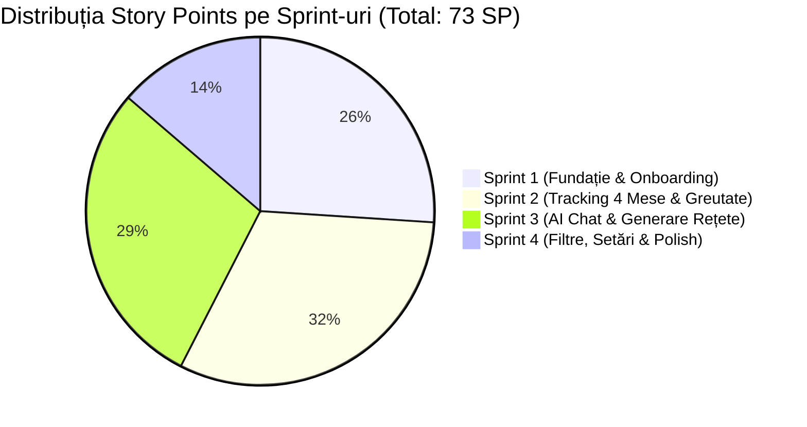

# 📋 Product Backlog Complet – DietNow

Acest document reprezintă **Product Backlog-ul oficial și complet** al proiectului **DietNow**, conceput conform standardelor metodologiei **Agile / Scrum**. Documentul conține descompunerea pe **Epic-uri**, descrierea granulară a fiecărui **User Story**, **Criteriile de Acceptanță (Given-When-Then)**, **Sarcinile Tehnice**, **Prioritizarea MoSCoW**, **Estimarea în Story Points (Planning Poker - Fibonacci)** și **Alocarea pe Sprint-uri**.

---

## 🧭 1. Cadrul de Referință Agile

### 1.1. Product Goal
> *"Dezvoltarea și lansarea unui MVP web/mobile intuitiv (DietNow) care permite utilizatorilor să își configureze profilul biometric și obiectivul de greutate (bulk/cut/menținere), să monitorizeze aportul caloric zilnic pe 4 mese (Breakfast, Lunch, Dinner, Snacks), să urmărească evoluția greutății și să primească recomandări de rețete în timp real printr-un Asistent AI conversațional adaptat preferințelor culinare și ingredientelor disponibile."*

### 1.2. Definiția lui "Gata" (Definition of Done - DoD)
O poveste de utilizator (User Story) este considerată **DONE** numai dacă:
1. Codul sursă este scris conform standardelor de codare ale echipei și respectă arhitectura stabilită.
2. Sunt îndeplinite toate Criteriile de Acceptanță (Acceptance Criteria).
3. Codul este integrat pe ramura principală (`develop` / `main`) printr-un Pull Request validat de cel puțin un alt membru al echipei (Code Review).
4. Testele unitare și de integrare relevante sunt scrise și trec cu succes.
5. Interfața este testată și responsive pe cel puțin două rezoluții (Mobile & Desktop).
6. Nu există erori critice sau blocante nerezolvate.

### 1.3. Definiția lui "Pregătit" (Definition of Ready - DoR)
O poveste de utilizator este considerată **READY** pentru a fi inclusă într-un Sprint dacă:
1. Este clar exprimată în formatul standard (*Ca... / Doresc... / Astfel încât...*).
2. Are criterii de acceptanță explicite (format *Given-When-Then*).
3. Este estimată de echipă în Story Points.
4. Dependențele tehnice sunt identificate și rezolvate.
5. Respectă principiile **INVEST** (Independent, Negotiable, Valuable, Estimable, Small, Testable).

---

## 📊 2. Matricea Centralizată a Product Backlog-ului (Master Table)

Tabel pregătit pentru utilizare directă în documentație, Excel, Google Sheets sau import în Jira / GitHub Projects.

| ID Story | Epic | Titlu User Story | Prioritate MoSCoW | Estimare (Story Points) | Valoare Business (1-10) | Complexitate Tehnică (1-10) | Sprint Alocat | Dependențe |
| :---: | :--- | :--- | :---: | :---: | :---: | :---: | :---: | :--- |
| **US-01** | Autentificare | Înregistrare cont și Login securizat (JWT) | **MUST** | **5 SP** | 9 | 5 | Sprint 1 | - |
| **US-02** | Onboarding | Chestionar date biometrice (Sex, Înălțime, Greutate, Activitate) | **MUST** | **5 SP** | 10 | 4 | Sprint 1 | US-01 |
| **US-03** | Onboarding | Definire obiectiv greutate bulk/cut și orizont de timp | **MUST** | **3 SP** | 10 | 3 | Sprint 1 | US-02 |
| **US-04** | Calcul Metabolic | Algoritm calcul BMR, TDEE și necesar caloric zilnic | **MUST** | **3 SP** | 10 | 4 | Sprint 1 | US-02, US-03 |
| **US-05** | Calcul Metabolic | Calcul și distribuție macronutrienți (Proteine, Carbo, Grăsimi) | **MUST** | **3 SP** | 9 | 3 | Sprint 1 | US-04 |
| **US-06** | Tracking Mese | Structură jurnal zilnic pe 4 mese (Breakfast, Lunch, Dinner, Snacks) | **MUST** | **5 SP** | 10 | 5 | Sprint 2 | US-01, US-05 |
| **US-07** | Tracking Mese | Bază de date alimente și căutare rapidă de produse | **MUST** | **5 SP** | 9 | 6 | Sprint 2 | US-06 |
| **US-08** | Tracking Mese | Înregistrare porție (grame) și calcul instant nutrienți masă | **MUST** | **5 SP** | 9 | 5 | Sprint 2 | US-07 |
| **US-09** | Dashboard | Dashboard progres zilnic (Calorii rămase și bare macronutrienți) | **MUST** | **5 SP** | 10 | 4 | Sprint 2 | US-06, US-08 |
| **US-10** | Evoluție Greutate | Logare cântărire periodică și salvare istoric greutate | **MUST** | **3 SP** | 8 | 3 | Sprint 2 | US-01 |
| **US-11** | Evoluție Greutate | Grafic vizual evoluție greutate vs. target de bulk/cut | **SHOULD** | **5 SP** | 8 | 5 | Sprint 2 | US-10, US-03 |
| **US-12** | Planuri Alimentare | Vizualizare și selectare plan alimentar (High-Protein, Balanced, etc.) | **SHOULD** | **3 SP** | 7 | 3 | Sprint 3 | US-05 |
| **US-13** | AI Nutrition Chat | Conectare API LLM și interfață de chat conversațional | **MUST** | **5 SP** | 9 | 6 | Sprint 3 | US-01 |
| **US-14** | AI Nutrition Chat | Prompt contextualizat (AI conștient de sex, kg, bulk și calorii rămase) | **MUST** | **5 SP** | 9 | 6 | Sprint 3 | US-13, US-04, US-09 |
| **US-15** | AI Nutrition Chat | Generare rețete pe baza ingredientelor disponibile în frigider | **MUST** | **8 SP** | 10 | 7 | Sprint 3 | US-14 |
| **US-16** | AI Nutrition Chat | Salvare rețetă recomandată de AI în colecția de Favorite | **SHOULD** | **3 SP** | 8 | 3 | Sprint 3 | US-15 |
| **US-17** | AI Nutrition Chat | Filtrare rețete AI după intoleranțe și preferințe (fără lactoză, vegan) | **SHOULD** | **3 SP** | 8 | 4 | Sprint 4 | US-15 |
| **US-18** | Profil Utilizator | Modificare date profil (actualizare înălțime, nivel activitate, obiectiv nou) | **SHOULD** | **3 SP** | 7 | 3 | Sprint 4 | US-02, US-04 |
| **US-19** | Tracking Mese | Adăugare aliment personalizat / rețetă proprie în baza de date | **SHOULD** | **5 SP** | 7 | 4 | Sprint 4 | US-07 |
| **US-20** | Tracking Mese | Scanare cod de bare pentru căutare automată aliment | **COULD** | **8 SP** | 6 | 8 | Backlog Viitor | US-07 |
| **US-21** | Raportare | Export PDF săptămânal cu sumarul evoluției nutriționale și a greutății | **COULD** | **5 SP** | 5 | 5 | Backlog Viitor | US-09, US-11 |
| **US-22** | Dispozitive | Sincronizare automată date cu Apple Health / Google Fit | **WON'T** | **13 SP** | 4 | 9 | Versiunea 2.0 | US-10 |

---

## 🧩 3. Descrierea Detaliată a User Stories pe Epic-uri

---

### EPIC 1: Autentificare, Onboarding & Profilare Biometrică

#### 🔹 US-01: Înregistrare și autentificare cont utilizator
- **Format:** Ca utilizator nou, doresc să îmi pot crea un cont securizat cu email și parolă și să mă autentific, astfel încât datele mele biometrice și istoricul nutrițional să fie protejate și sincronizate.
- **Prioritate:** **MUST HAVE** | **Estimare:** **5 SP** | **Sprint:** 1
- **Criterii de Acceptanță:**
  - **Scenariul 1 (Înregistrare cu date valide):**
    - *Given:* Utilizatorul completează formularul de înregistrare cu un email valid și o parolă de minim 8 caractere (inclusiv o cifră);
    - *When:* Apasă butonul „Creează Cont”;
    - *Then:* Contul este creat în baza de date, parola este hash-uită (bcrypt), se emite un token JWT și este redirecționat către Onboarding.
  - **Scenariul 2 (Email duplicat):**
    - *Given:* Utilizatorul introduce o adresă de email deja existentă în sistem;
    - *When:* Trimite formularul;
    - *Then:* Sistemul afișează eroarea „Acest email este deja asociat unui cont existent” fără a expune alte date.
- **Sarcini Tehnice:**
  - Backend: Endpoint POST `/api/auth/register` și POST `/api/auth/login`.
  - Backend: Middleware de verificare token JWT.
  - Frontend: Ecrane Login și Register cu validare de formular (formik / react-hook-form + yup / zod).

---

#### 🔹 US-02: Chestionar de colectare a datelor biometrice inițiale
- **Format:** Ca utilizator nou autentificat, doresc să completez un chestionar intuitiv cu datele mele (sex biologic, vârstă, înălțime, greutate curentă, nivel de activitate), astfel încât sistemul să îmi cunoască profilul fizic de pornire.
- **Prioritate:** **MUST HAVE** | **Estimare:** **5 SP** | **Sprint:** 1
- **Criterii de Acceptanță:**
  - **Scenariul 1 (Completare completă și corectă):**
    - *Given:* Utilizatorul este la pasul 1 din Onboarding;
    - *When:* Selectează sexul (Masc/Fem), introduce vârsta (ex: 21), înălțimea (ex: 182 cm), greutatea actuală (ex: 72.5 kg) și nivelul de activitate (ex: Moderat activ - 3-5 antrenamente/săpt.);
    - *Then:* Câmpurile sunt validate ca valori pozitive reale, iar starea formularului avansează la pasul următor.
  - **Scenariul 2 (Valori aberante sau lipsă):**
    - *Given:* Utilizatorul introduce o înălțime de 30 cm sau lasă greutatea necompletată;
    - *When:* Apasă „Continuă”;
    - *Then:* Câmpul eronat este evidențiat în roșu cu mesajul „Vă rugăm introduceți o valoare realistă (între 120 și 250 cm)”.
- **Sarcini Tehnice:**
  - Frontend: Stepper interactiv de onboarding (responsive, card-uri mari pentru selecția sexului și activității).
  - Backend: Salvare atribute biometrice în tabela `user_profiles`.

---

#### 🔹 US-03: Definirea obiectivului de greutate (Bulk / Cut / Menținere) și a termenului
- **Format:** Ca utilizator, doresc să aleg dacă obiectivul meu este creștere în greutate (bulk), scădere (cut) sau menținere, să specific greutatea țintă și numărul de săptămâni/luni dorit, astfel încât aplicația să personalizeze ritmul progresului.
- **Prioritate:** **MUST HAVE** | **Estimare:** **3 SP** | **Sprint:** 1
- **Criterii de Acceptanță:**
  - **Scenariul 1 (Configurare obiectiv de Bulk sănătos):**
    - *Given:* Utilizatorul are 70 kg și selectează obiectivul „Creștere masă (Bulk)”;
    - *When:* Introduce greutatea țintă 76 kg și orizontul de 12 săptămâni;
    - *Then:* Sistemul validează că rata de creștere este rezonabilă (~0.5 kg / săptămână) și confirmă configurarea obiectivului.
  - **Scenariul 2 (Avertizare pentru ritm nerealist/periculos):**
    - *Given:* Utilizatorul cere să pună 15 kg în 2 săptămâni;
    - *When:* Apasă confirmare;
    - *Then:* Sistemul afișează un avertisment prietenos: „Un ritm mai sustenabil recomandat este între 0.25 și 0.5 kg pe săptămână pentru a maximiza masa musculară și a limita acumularea de grăsime”.
- **Sarcini Tehnice:**
  - Frontend: Slider interactiv pentru greutate țintă și săptămâni.
  - Backend: Câmpuri `goal_type`, `target_weight`, `target_timeline_weeks` în baza de date.

---

### EPIC 2: Calcul Metabolic & Planuri de Alimentație

#### 🔹 US-04: Algoritm automat pentru BMR, TDEE și target caloric zilnic
- **Format:** Ca utilizator, doresc ca aplicația să calculeze automat Rata Metabolică Bazală (BMR) și Consumul Total Zilnic (TDEE) și să aplice surplusul de bulk sau deficitul de cut, astfel încât să știu exact câte calorii trebuie să consum în fiecare zi.
- **Prioritate:** **MUST HAVE** | **Estimare:** **3 SP** | **Sprint:** 1
- **Criterii de Acceptanță:**
  - **Scenariul 1 (Calcul precis pe baza formulei Mifflin-St Jeor):**
    - *Given:* Bărbat, 70 kg, 180 cm, 22 ani:
      $BMR = (10 \times 70) + (6.25 \times 180) - (5 \times 22) + 5 = 700 + 1125 - 110 + 5 = 1720\text{ kcal}$;
    - *When:* Nivelul este „Moderat activ” (multiplicator 1.55), $TDEE = 1720 \times 1.55 \approx 2666\text{ kcal}$;
    - *Then:* Pentru un obiectiv de bulk moderat, sistemul adaugă un surplus de +400 kcal, stabilind targetul zilnic la $3066\text{ kcal/zi}$.
- **Sarcini Tehnice:**
  - Backend: Modul matematic `nutritionCalculator.ts` / `calculator.py`.
  - Testare: Teste unitare cu valori etalon pentru diverse combinații de sex, înălțime și activitate.

---

#### 🔹 US-05: Calculul și repartiția optimă a macronutrienților
- **Format:** Ca utilizator orientat pe fitness/bulk, doresc să primesc o repartiție clară a caloriilor în grame de Proteine, Carbohidrați și Grăsimi, astfel încât să îmi optimizez sinteza musculară și energia la antrenamente.
- **Prioritate:** **MUST HAVE** | **Estimare:** **3 SP** | **Sprint:** 1
- **Criterii de Acceptanță:**
  - **Scenariul 1 (Repartiție Bulk High-Protein):**
    - *Given:* Utilizatorul are setat obiectivul de bulk;
    - *When:* Sistemul generează macro-urile;
    - *Then:* Alocă:
      - Proteine: $2.0\text{ g/kg corp}$ (4 kcal/g);
      - Grăsimi: $1.0\text{ g/kg corp}$ (9 kcal/g);
      - Carbohidrați: restul de calorii rămase împărțite la 4 kcal/g.
- **Sarcini Tehnice:**
  - Backend: Generare obiect JSON `{ daily_calories: 3050, protein_g: 140, carbs_g: 450, fats_g: 75 }`.
  - Frontend: Grafic circular sau bare colorate pentru raportul de macro-uri.

---

#### 🔹 US-12: Vizualizarea și selectarea planului de alimentație
- **Format:** Ca utilizator, doresc să pot alege dintr-o listă de planuri alimentare (ex: High-Protein Bulk, Balanced Diet, Vegetarian / Vegan, Low-Carb), astfel încât repartiția caloriilor și recomandările de rețete să se plieze pe stilul meu de viață.
- **Prioritate:** **SHOULD HAVE** | **Estimare:** **3 SP** | **Sprint:** 3
- **Criterii de Acceptanță:**
  - **Scenariul 1 (Alegerea unui plan Vegetarian):**
    - *Given:* Utilizatorul accesează secțiunea „Planuri de Alimentație”;
    - *When:* Selectează planul „Vegetarian High-Protein”;
    - *Then:* Sursele proteice prioritizate în aplicație și recomandările din AI Chat devin vegetariene (tofu, soia, ouă, linte, brânză).
- **Sarcini Tehnice:**
  - Frontend: Pagina de selecție cu carduri informative pentru fiecare tip de plan.
  - Backend: Actualizare proprietate `diet_plan` în profilul utilizatorului.

---

### EPIC 3: Monitorizare Nutrițională & Jurnal Zilnic pe 4 Mese

#### 🔹 US-06: Structură jurnal zilnic organizat pe 4 mese distincte
- **Format:** Ca utilizator, doresc ca jurnalul meu alimentar zilnic să fie structurat clar pe cele 4 mese: **Breakfast** (Mic dejun), **Lunch** (Prânz), **Dinner** (Cină) și **Snacks** (Gustări), astfel încât să îmi pot organiza consumul alimentar pe tot parcursul zilei.
- **Prioritate:** **MUST HAVE** | **Estimare:** **5 SP** | **Sprint:** 2
- **Criterii de Acceptanță:**
  - **Scenariul 1 (Afișarea celor 4 secțiuni):**
    - *Given:* Utilizatorul deschide pagina principală de jurnal pentru data curentă;
    - *When:* Pagina este randată;
    - *Then:* Sunt vizibile cele 4 secțiuni separate, fiecare afișând subtotalul de calorii și un buton „+ Adaugă Aliment”.
  - **Scenariul 2 (Navigare între zile):**
    - *Given:* Utilizatorul dorește să vadă ce a mâncat ieri;
    - *When:* Folosește selectorul de dată (săgeată stânga / calendar);
    - *Then:* Jurnalul se reîncarcă cu datele aferente zilei selectate.
- **Sarcini Tehnice:**
  - Frontend: Componentă reutilizabilă `MealSectionCard` pentru fiecare categorie de masă.
  - Backend: Endpoint GET `/api/logs/daily?date=YYYY-MM-DD`.

---

#### 🔹 US-07: Bază de date de alimente și căutare rapidă
- **Format:** Ca utilizator, doresc să caut rapid un aliment după nume dintr-o bază de date cu valori nutriționale verificate, astfel încât să îl găsesc în câteva secunde.
- **Prioritate:** **MUST HAVE** | **Estimare:** **5 SP** | **Sprint:** 2
- **Criterii de Acceptanță:**
  - **Scenariul 1 (Căutare după cuvânt cheie):**
    - *Given:* Utilizatorul tastează „piept de pui” în bara de căutare;
    - *When:* Tastează cel puțin 2 caractere;
    - *Then:* Sistemul afișează o listă de rezultate cu denumirea și caloriile/macro-urile per 100g.
- **Sarcini Tehnice:**
  - Bază de date: Tabela `foods` populată inițial cu alimente comune (surse verified nutrition / USDA / Open Food Facts).
  - Backend: Endpoint GET `/api/foods/search?q=query` cu indexare full-text.

---

#### 🔹 US-08: Înregistrarea cantității consumate și calculul instant
- **Format:** Ca utilizator, doresc să specific cantitatea consumată (în grame sau porții) pentru un aliment selectat, astfel încât sistemul să calculeze instant caloriile, proteinele, carbohidrații și grăsimile aferente.
- **Prioritate:** **MUST HAVE** | **Estimare:** **5 SP** | **Sprint:** 2
- **Criterii de Acceptanță:**
  - **Scenariul 1 (Adăugare 150g orez fiert la Lunch):**
    - *Given:* Utilizatorul a selectat „Orez fiert” (130 kcal/100g);
    - *When:* Introduce cantitatea de „150” grame și confirmă;
    - *Then:* Masa de Prânz este creditată cu 195 kcal, iar alimentul apare listat sub „Lunch”.
  - **Scenariul 2 (Ștergere aliment înregistrat greșit):**
    - *Given:* Un aliment adăugat din greșeală;
    - *When:* Utilizatorul apasă iconița de ștergere;
    - *Then:* Elementul dispare, iar totalurile sunt scăzute instant.
- **Sarcini Tehnice:**
  - Backend: Endpoint POST `/api/logs/meal-item` și DELETE `/api/logs/meal-item/:id`.
  - Frontend: Modal de introducere grame cu recalculare live în UI înainte de submit.

---

#### 🔹 US-09: Dashboard central de progres nutrițional
- **Format:** Ca utilizator, doresc ca ecranul principal să îmi afișeze un sumar vizual atractiv (Calorii consumate vs. Rămase și 3 bare de progres pentru Proteine, Carbohidrați, Grăsimi), astfel încât să văd dintr-o privire dacă mai am "spațiu" pentru cină sau gustări.
- **Prioritate:** **MUST HAVE** | **Estimare:** **5 SP** | **Sprint:** 2
- **Criterii de Acceptanță:**
  - **Scenariul 1 (Actualizare dinamică a caloriilor rămase):**
    - *Given:* Targetul este de 3000 kcal, iar consumul curent este de 1800 kcal;
    - *When:* Dashboard-ul este deschis;
    - *Then:* Cercul central afișează: „1200 kcal Rămase”, iar bara de proteine arată procentul atins (ex: 90g / 150g = 60%).
- **Sarcini Tehnice:**
  - Frontend: Componentă Dashboard cu animație fluidă a progresului (SVG / Canvas / Tailwind UI).

---

### EPIC 4: Monitorizare Progres & Evoluție Greutate (Bulk/Cut)

#### 🔹 US-10: Înregistrarea periodică a greutății corporale
- **Format:** Ca utilizator, doresc să îmi pot nota greutatea măsurată dimineața (în kg, cu o zecimală), astfel încât să am un jurnal complet al cântăririlor mele.
- **Prioritate:** **MUST HAVE** | **Estimare:** **3 SP** | **Sprint:** 2
- **Criterii de Acceptanță:**
  - **Scenariul 1 (Salvare cântărire):**
    - *Given:* Utilizatorul deschide modulul de greutate;
    - *When:* Introduce „71.4” kg și apasă „Salvează greutatea”;
    - *Then:* Greutatea este salvată pentru data curentă în istoricul de greutate.
- **Sarcini Tehnice:**
  - Backend: Tabela `weight_logs` (user_id, weight_kg, recorded_date).
  - Frontend: Câmp numeric rapid cu buton de logare pe ecranul principal.

---

#### 🔹 US-11: Grafic vizual al evoluției greutății în raport cu targetul
- **Format:** Ca utilizator în proces de bulk/cut, doresc să văd un grafic cu evoluția mea în timp și o linie punctată a obiectivului meu, astfel încât să știu dacă ritmul meu de creștere/scădere este conform planului.
- **Prioritate:** **SHOULD HAVE** | **Estimare:** **5 SP** | **Sprint:** 2
- **Criterii de Acceptanță:**
  - **Scenariul 1 (Afișare grafic cu trend):**
    - *Given:* Utilizatorul are cel puțin 3 înregistrări de greutate în ultimele săptămâni;
    - *When:* Accesează tab-ul „Progres”;
    - *Then:* Este randat un grafic de tip linie (Line Chart) cu punctele istorice și o linie de referință reprezentând greutatea țintă.
- **Sarcini Tehnice:**
  - Frontend: Integrare bibliotecă de grafice (ex: Chart.js, Recharts sau Recharts-React).

---

### EPIC 5: Asistent AI Nutrițional & Recomandare Rețete (AI Chat)

#### 🔹 US-13: Conectare API LLM și interfață de chat conversațional
- **Format:** Ca utilizator, doresc să am acces la o secțiune de Chat cu un asistent virtual prietenos și specializat pe nutriție, astfel încât să pot discuta liber despre mâncare și rețete.
- **Prioritate:** **MUST HAVE** | **Estimare:** **5 SP** | **Sprint:** 3
- **Criterii de Acceptanță:**
  - **Scenariul 1 (Trimitere și primire mesaj chat):**
    - *Given:* Utilizatorul este pe ecranul „AI Assistant”;
    - *When:* Scrie un mesaj și apasă Send;
    - *Then:* Mesajul apare pe ecran, se afișează un indicator de scriere („DietNow AI gândește...”) și răspunsul AI-ului este afișat în format streaming.
- **Sarcini Tehnice:**
  - Backend: Gateway API pentru LLM (Google Gemini API SDK / OpenAI SDK) cu suport Server-Sent Events (SSE) pentru streaming.
  - Frontend: Interfață de chat modernă (bule de dialog, auto-scroll la ultimul mesaj).

---

#### 🔹 US-14: Asistent AI contextualizat cu datele biometrice și jurnalul zilei
- **Format:** Ca utilizator, doresc ca Asistentul AI să știe automat cine sunt, că sunt în faza de bulk și câte calorii mai am de mâncat azi, astfel încât să nu fiu nevoit să îi reamintesc aceste detalii la fiecare întrebare.
- **Prioritate:** **MUST HAVE** | **Estimare:** **5 SP** | **Sprint:** 3
- **Criterii de Acceptanță:**
  - **Scenariul 1 (Recomandare automată adaptată caloriilor rămase):**
    - *Given:* Utilizatorul mai are 600 kcal și 40g proteine disponibile pentru cină;
    - *When:* Întreabă AI-ul: „Ce să mănânc la cină?”;
    - *Then:* AI-ul formulează o propunere direct calibrată: „Având în vedere că mai ai 600 kcal și ai nevoie de 40g proteine pentru obiectivul tău de bulk, îți propun o cină cu...”.
- **Sarcini Tehnice:**
  - Backend: Prompt Engineering & System Prompt injection dinamic (injectează: sex, greutate, target, calorii rămase, preferințe salvate).

---

#### 🔹 US-15: Generare de rețete pe baza ingredientelor din frigider
- **Format:** Ca utilizator care are doar câteva ingrediente în bucătărie, doresc să îi scriu asistentului AI ce am în frigider (ex: ouă, cartofi, brânză) și pentru ce masă doresc rețeta (Breakfast, Lunch, Dinner, Snacks), astfel încât AI-ul să compună o rețetă delicioasă și exactă.
- **Prioritate:** **MUST HAVE** | **Estimare:** **8 SP** | **Sprint:** 3
- **Criterii de Acceptanță:**
  - **Scenariul 1 (Format structurat al rețetei generate):**
    - *Given:* Utilizatorul transmite ingredientele: „am ton la conservă, paste integrale și porumb”;
    - *When:* AI-ul răspunde;
    - *Then:* Răspunsul este structurat obligatoriu cu:
      1. Numele rețetei;
      2. Ingrediente și cantități recomandate;
      3. Timp de preparare;
      4. Pași de gătire numerotați;
      5. Tabel estimativ de Macronutrienți (Calorii, Proteine, Carbohidrați, Grăsimi).
- **Sarcini Tehnice:**
  - Prompt Engineering: Forțare răspuns structurat JSON / Markdown cu delimitatori clari pentru card de rețetă.
  - Frontend: Randare formatată tip „Card Rețetă” cu buton rapid de copiere sau salvare.

---

#### 🔹 US-16: Salvarea rețetelor generate de AI în colecția de Favorite
- **Format:** Ca utilizator, doresc să pot salva o rețetă recomandată de AI printr-un singur click pe iconița de „Favorite”, astfel încât să o pot regăsi oricând în profilul meu fără să o regenerez.
- **Prioritate:** **SHOULD HAVE** | **Estimare:** **3 SP** | **Sprint:** 3
- **Criterii de Acceptanță:**
  - **Scenariul 1 (Salvare rețetă):**
    - *Given:* Rețeta generată este afișată în chat;
    - *When:* Utilizatorul apasă butonul „⭐ Salvează în Favorite”;
    - *Then:* Rețeta este stocată în baza de date și devine vizibilă în tab-ul „Rețete Favorite”.
- **Sarcini Tehnice:**
  - Bază de date: Tabela `favorite_recipes` (id, user_id, title, ingredients_json, instructions, calories, macros).
  - Frontend: Buton de acțiune direct în bucla mesajului AI.

---

#### 🔹 US-17: Filtrare rețete AI după intoleranțe și restricții dietetice
- **Format:** Ca utilizator cu restricții alimentare (ex: fără lactoză, fără gluten, vegan, fără nuci), doresc ca AI-ul să respecte strict aceste excluderi în orice rețetă propusă, astfel încât sănătatea mea să fie protejată.
- **Prioritate:** **SHOULD HAVE** | **Estimare:** **3 SP** | **Sprint:** 4
- **Criterii de Acceptanță:**
  - **Scenariul 1 (Excludere garantată a alergenilor):**
    - *Given:* Utilizatorul a bifat „Intoleranță la lactoză” în setări;
    - *When:* Cere o rețetă de snack dulce;
    - *Then:* Rețeta nu conține lapte, unt sau iaurt convențional, recomandând înlocuitori (lapte de migdale, iaurt de cocos etc.).
- **Sarcini Tehnice:**
  - Backend: Reguli de tip "Guardrails" în system prompt-ul LLM.

---

### EPIC 6: Setări, Profil & Ajustări Progresive

#### 🔹 US-18: Modificarea datelor din profil și recalcularea planului
- **Format:** Ca utilizator al cărui nivel de activitate sau obiectiv s-a schimbat, doresc să îmi actualizez datele biometrice din Setări, astfel încât noile valori de BMR/TDEE să se recalculeze automat.
- **Prioritate:** **SHOULD HAVE** | **Estimare:** **3 SP** | **Sprint:** 4
- **Criterii de Acceptanță:**
  - **Scenariul 1 (Recalculare după atingerea greutății):**
    - *Given:* Utilizatorul a atins greutatea de bulk și dorește trecerea la menținere;
    - *When:* Comută obiectivul pe „Menținere”;
    - *Then:* Surplusul caloric este anulat, noul target zilnic fiind egal cu TDEE-ul curent.
- **Sarcini Tehnice:**
  - Backend: Endpoint PUT `/api/profile` cu apelare automată a funcției de recalculare a planului.

---

#### 🔹 US-19: Adăugarea de alimente personalizate sau rețete proprii
- **Format:** Ca utilizator, doresc să adaug manual un aliment cu eticheta sa nutrițională dacă nu îl găsesc în baza de date standard, astfel încât să îl pot refolosi la viitoarele logări.
- **Prioritate:** **SHOULD HAVE** | **Estimare:** **5 SP** | **Sprint:** 4
- **Criterii de Acceptanță:**
  - **Scenariul 1 (Creare aliment custom):**
    - *Given:* Utilizatorul nu găsește un produs local la căutare;
    - *When:* Introduce Nume, Kcal, Proteine, Carbo și Grăsimi per 100g și salvează;
    - *Then:* Produsul apare în secțiunea „Alimentele Mele” și poate fi adăugat la orice masă.
- **Sarcini Tehnice:**
  - Backend: Câmp `created_by_user_id` în tabela `foods`.

---

## 🚀 4. Planificarea pe Sprint-uri (Sprint Breakdown)

Alocarea este calibrată pentru o echipă de studenți cu o viteză medie de **~15 - 20 Story Points / Sprint** (durată Sprint: 2 săptămâni).

### 🗓️ Sprint 1: Fundație, Autentificare & Onboarding Biometric
- **Obiectiv Sprint 1:** Utilizatorul se poate înregistra/autentifica, parcurge chestionarul complet (sex, înălțime, kg, activitate, obiectiv bulk/cut, timp) și primește instant targetul de calorii și macronutrienți.
- **Stories incluse:**
  - `US-01`: Înregistrare & Login JWT (5 SP)
  - `US-02`: Chestionar date biometrice (5 SP)
  - `US-03`: Obiectiv bulk/cut și orizont de timp (3 SP)
  - `US-04`: Algoritm calcul BMR și TDEE (3 SP)
  - `US-05`: Repartiție macronutrienți (3 SP)
- **Total Sprint 1:** **19 Story Points**

---

### 🗓️ Sprint 2: Core Tracking – Jurnal pe 4 Mese & Monitorizare Greutate
- **Obiectiv Sprint 2:** Utilizatorul poate loga alimente pe cele 4 mese (Breakfast, Lunch, Dinner, Snacks), vede barele de progres în dashboard și își poate nota evoluția greutății cu reprezentare grafică.
- **Stories incluse:**
  - `US-06`: Structură jurnal zilnic pe 4 mese (5 SP)
  - `US-07`: Bază de date alimente și căutare (5 SP)
  - `US-08`: Înregistrare porții și calcul automat (5 SP)
  - `US-09`: Dashboard progres calorii & macronutrienți (5 SP)
  - `US-10`: Logare greutate periodică (3 SP)
  - *(Opțional/Bonus)* `US-11`: Grafic vizual evoluție greutate (5 SP)
- **Total Sprint 2:** **23 Story Points**

---

### 🗓️ Sprint 3: Asistent AI Nutrițional & Recomandare Rețete
- **Obiectiv Sprint 3:** Utilizatorul poate deschide fereastra de AI Chat, iar asistentul (cunoscându-i profilul de bulk și caloriile rămase) îi generează rețete personalizate pe baza ingredientelor specificate, permițând salvarea în Favorite.
- **Stories incluse:**
  - `US-13`: Conectare API LLM și interfață chat (5 SP)
  - `US-14`: Context-awareness AI (profil, calorii rămase, bulk) (5 SP)
  - `US-15`: Generare rețete pe baza ingredientelor (8 SP)
  - `US-16`: Salvare rețetă în Favorite (3 SP)
  - *(Parțial)* `US-12`: Selecție plan alimentar (3 SP)
- **Total Sprint 3:** **21 - 24 Story Points**

---

### 🗓️ Sprint 4: Rafinare, Restricții Culinare, QA & Pregătire Prezentare
- **Obiectiv Sprint 4:** Finalizarea filtrelor pentru intoleranțe alimentare, editarea profilului, testare integrală (DoD) și pregătirea demonstratorului pentru evaluarea finală.
- **Stories incluse:**
  - `US-17`: Filtrare rețete AI după intoleranțe/alergii (3 SP)
  - `US-18`: Editare date profil și recalculare plan (3 SP)
  - `US-19`: Adăugare alimente personalizate (5 SP)
  - Testare End-to-End, rezolvare bug-uri și optimizări UI/UX.
- **Total Sprint 4:** **11 Story Points + Bug Fixing & Polish**

---

## 📈 5. Tehnica de Estimare și Justificarea Punctelor (Story Points)

- **Scara Fibonacci:** Echipa a utilizat valorile **1, 2, 3, 5, 8, 13**.
- **Punct de referință (Anchor Story):** `US-04` (Calcul BMR/TDEE) a fost evaluat la **3 SP** (logică algoritmică clară, formule matematice bine definite, efort moderat).
- **Poveștile de 5 SP** (ex: `US-01` Auth, `US-06` Jurnal 4 Mese, `US-13` Conexiune LLM) implică atât logică de backend, cât și componente interactive de frontend și comunicare securizată.
- **Poveștile de 8 SP** (ex: `US-15` Generare rețete inteligente și `US-20` Scanare coduri de bare) implică complexitate ridicată, gestionare de prompturi asincrone, parsare JSON imprevizibilă sau integrare hardware (cameră foto mobilă).

---

*Acest Product Backlog este gata de prezentat în cadrul laboratorului și de integrat în instrumentele de management de proiect (Jira, GitHub Projects, Trello).*
