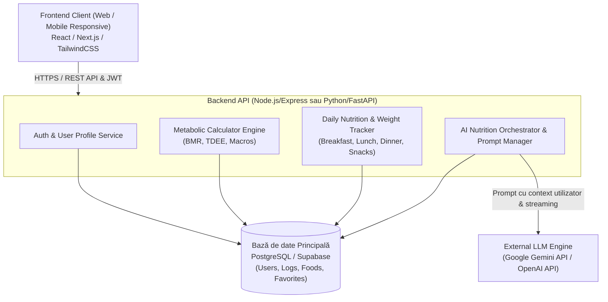

# Documentație Proiect: DietNow
## Etapa 1 (Săptămânile 3-4): Cerințe, Product Goal și Product Backlog Inițial

---

## 1. Constituirea Echipei (Team Setup)

Pentru dezvoltarea proiectului **DietNow** a fost adoptată metodologia agilă **Scrum**, asigurând roluri clare, transparență și iterații rapide.

### 1.1. Roluri Scrum și Responsabilități

| Rol Scrum | Nume Membru | Responsabilități Principale |
| :--- | :--- | :--- |
| **Product Owner (PO)** | *(Nume Membru 1)* | Definește viziunea produsului, elaborează și prioritizează Product Backlog-ul, validează criteriile de acceptanță ale User Stories, menține comunicarea cu stakeholderii / profesorul coordonator. |
| **Scrum Master (SM)** | *(Nume Membru 2)* | Asigură respectarea procesului Scrum, facilitează ședințele (Daily, Planning, Review, Retro), înlătură blocajele echipei și menține ritmul de livrare. |
| **Full-Stack Developer (Lead Frontend & UI/UX)** | *(Nume Membru 3)* | Proiectează și dezvoltă interfața utilizator (onboarding, formulare biometrice, dashboard de tracking, ecranul de chat AI), asigură design responsive și experiență fluidă. |
| **Full-Stack Developer (Lead Backend & Baze de Date)** | *(Nume Membru 4)* | Implementează arhitectura API, autentificarea securizată, logica de calcul BMR/TDEE/Macro, modelarea și optimizarea bazei de date. |
| **AI Integration & Prompt Engineer** | *(Nume Membru 5 / sau comun)* | Integrează API-ul LLM (Google Gemini / OpenAI), concepe prompt-urile de sistem, gestionează contextul conversației (macro target, preferințe) și formatarea rețetelor generate. |
| **QA Engineer / Tester** | *(Nume Membru 6 / rotație)* | Definește planul de testare, scrie teste automate (unitare, de integrare, e2e) și realizează testarea manuală a fluxurilor utilizator conform criteriilor de acceptanță. |

> *Notă: În funcție de mărimea exactă a echipei voastre (de ex. 3-5 membri), rolurile pot fi cumulate (ex: un membru poate fi Full-Stack Dev + QA).*

### 1.2. Reguli și Ceremonii de Echipă
- **Durata Sprint-ului:** 2 săptămâni.
- **Daily Scrum:** 15 minute (luni, miercuri, vineri) online (Discord / Google Meet) sau fizic: ce am făcut, ce fac azi, ce blocaje am.
- **Managementul Sarcinilor:** GitHub Projects / Trello / Jira pentru vizualizarea Kanban a sarcinilor (To Do, In Progress, Code Review, Done).
- **Controlul Versiunilor:** Git cu model de lucru GitFlow / GitHub Flow (ramuri dedicate de tip `feature/us-XX-descriere`, Pull Requests cu review obligatoriu de la cel puțin un coleg).

---

## 2. Alegerea Temei (Project Charter & Problem Statement)

### 2.1. Denumirea Proiectului
**DietNow** – Asistent Inteligent de Nutriție, Monitorizare Calorică și Recomandare de Rețete Asistat de AI.

### 2.2. Problema Adresată
Atingerea unui obiectiv fizic – fie că este vorba despre **creștere în masă musculară (bulk)**, **scădere în greutate (cut)** sau **menținere** – este deseori abandonată din următoarele motive:
1. **Dificultatea calculului caloric și a macronutrienților:** Mulți utilizatori nu știu câte calorii, proteine, carbohidrați și grăsimi trebuie să consume zilnic raportat la greutatea actuală, înălțime, sex și nivelul de activitate.
2. **"Decision fatigue" și monotonia alimentară:** Gătitul zilnic devine repetitiv, iar găsirea unor rețete rapide care să se încadreze exact în necesarul de calorii și proteine al zilei este consumatoare de timp.
3. **Rigiditatea aplicațiilor tradiționale de diet tracking:** Aplicațiile existente (MyFitnessPal, LoseIt) oferă tabele mari de date, dar nu ajută utilizatorul activ cu idei practice adaptate ingredientelor pe care le are deja în frigider și preferințelor personale (ex: fără lactoză, preferințe de gust).

### 2.3. Soluția DietNow și Valoarea Adăugată
DietNow unifică două module fundamentale într-o experiență modernă și accesibilă:
- **Modulul 1 – Onboarding inteligent & Tracking complet:** Utilizatorul răspunde la un set de întrebări la primul contact (sex, înălțime, greutate curentă, nivel de activitate, obiectiv de bulk/cut, greutate țintă și orizont de timp dorit). Sistemul calculează automat necesarul caloric și macro-urile optime și oferă un jurnal pe 4 categorii (*Breakfast*, *Lunch*, *Dinner*, *Snacks*), alături de un tracker al evoluției greutății în timp și posibilitatea alegerii unui plan de alimentație.
- **Modulul 2 – Chat AI Nutrițional Personalizat:** Un asistent inteligent conversațional căruia utilizatorul îi poate adresa cereri în limbaj natural (ex: *"Am la dispoziție 4 ouă, 100g brânză cottage și spanac. Recomandă-mi un mic dejun bogat în proteine de aproximativ 450 kcal"* sau *"Vreau o gustare dulce dar fără zahăr adăugat care să aibă sub 200 kcal"*). AI-ul cunoaște obiectivele și istoricul utilizatorului și generează rețete instantaneu, cu valori nutriționale estimate.

---

## 3. Requirements Document (Specificație de Cerințe Software)

### 3.1. User Personas

#### Persona 1: Andrei (Student, 21 ani) – "Hardgainer-ul în căutare de bulk curat"
- **Obiectiv:** Vrea să pună 5 kg de masă musculară în 3 luni (bulk sănătos), fără să acumuleze multă grăsime.
- **Nevoie:** Nu are timp să caute rețete complicate și vrea să știe exact cât surplus caloric să consume și ce gustări rapide bogate în proteine poate mânca între cursuri.
- **Frustrare:** Aplicațiile existente sunt greoaie, pline de reclame și nu îi spun *ce* să mănânce concret din ingredientele ieftine pe care le are.

#### Persona 2: Elena (Specialist Marketing, 27 ani) – "Stil de viață activ și echilibru"
- **Obiectiv:** Vrea să se mențină în formă, să mănânce variat și să își monitorizeze cele 4 mese zilnice.
- **Nevoie:** Îi place să discute cu asistentul AI pentru a primi rețete noi de cină fără lactoză, gata în maxim 20 de minute.
- **Frustrare:** Renunță la jurnalele clasice de dietă dacă procesul de logare durează mai mult de 2 minute pe zi.

---

### 3.2. Cerințe Funcționale (Functional Requirements - RF)

#### Modul A: Onboarding, Profilare și Calcul Metabolic
- **RF01 (Chestionar inițial):** Sistemul trebuie să ofere un flux de onboarding interactiv la prima autentificare, colectând:
  - Sex biologic (Feminin / Masculin);
  - Vârstă (ani);
  - Înălțime (cm);
  - Greutate actuală (kg);
  - Nivel de activitate fizică (Sedentar, Ușor activ, Moderat activ, Foarte activ);
  - Obiectiv principal (Creștere masă / Bulk, Scădere în greutate / Cut, Menținere);
  - Greutate țintă (kg);
  - Termen dorit pentru atingerea obiectivului (ex: săptămâni / luni).
- **RF02 (Calcul caloric algoritmic):** Sistemul trebuie să calculeze automat:
  - BMR (Basal Metabolic Rate) folosind formula standardizată Mifflin-St Jeor;
  - TDEE (Total Daily Energy Expenditure) pe baza factorului de activitate;
  - Necesarul caloric zilnic ajustat cu surplus caloric (+300 la +500 kcal pentru bulk) sau deficit (-300 la -500 kcal pentru cut);
  - Repartiția macronutrienților: Proteine (g), Carbohidrați (g), Grăsimi (g).
- **RF03 (Alegere Plan de Alimentație):** Sistemul trebuie să permită utilizatorului selectarea unui plan alimentar preferat (ex: High-Protein Bulk, Balanced Diet, Vegetarian / Vegan, Low-Carb).

#### Modul B: Tracking Nutrițional și Monitorizare Greutate
- **RF04 (Jurnal zilnic de mese):** Sistemul trebuie să pună la dispoziție un jurnal structurat pe 4 categorii distincte:
  1. *Breakfast* (Mic dejun)
  2. *Lunch* (Prânz)
  3. *Dinner* (Cină)
  4. *Snacks* (Gustări)
- **RF05 (Adăugare și căutare alimente):** Utilizatorul trebuie să poată căuta și adăuga alimente cu porția aferentă (grame / porții), sistemul adunând caloriile și macronutrienții.
- **RF06 (Dashboard progres zilnic):** Sistemul trebuie să afișeze în timp real caloriile consumate vs. caloriile rămase pentru ziua curentă, precum și bare de progres pentru proteine, carbohidrați și grăsimi.
- **RF07 (Monitorizare greutate):** Utilizatorul trebuie să poată introduce greutatea curentă la intervale regulate (zilnic/săptămânal), iar sistemul va afișa un grafic istoric al evoluției în raport cu greutatea țintă.

#### Modul C: Asistent Nutrițional AI (AI Chat)
- **RF08 (Interfață Chat AI):** Sistemul trebuie să ofere o fereastră de chat dedicată unde utilizatorul poate conversa natural cu un asistent virtual specializat în nutriție.
- **RF09 (Context-awareness în AI):** Asistentul AI trebuie să fie conștient de profilul utilizatorului (obiectivul curent de bulk/cut, targetul caloric, caloriile rămase în ziua respectivă, restricții alimentare salvate).
- **RF10 (Recomandare rețete pe baza preferințelor):** Asistentul AI trebuie să genereze rețete complete (ingrediente, mod de preparare, timp de gătire, valori nutriționale estimate) pe baza cerințelor utilizatorului (ex: preferințe culinare, ingrediente avute la dispoziție, mese rapide).
- **RF11 (Filtrare și restricții alimentare):** Utilizatorul trebuie să poată specifica intoleranțe sau preferințe (vegan, vegetarian, fără gluten, fără lactoză, keto), iar AI-ul va respecta strict aceste restricții în rețetele propuse.
- **RF12 (Salvare rețete favorite):** Utilizatorul trebuie să poată salva cu un singur click o rețetă recomandată de AI în colecția proprie de "Rețete Favorite".

#### Modul D: Autentificare și Administrare Cont
- **RF13 (Autentificare utilizator):** Înregistrare și autentificare securizată (Email & Parolă, opțional Google OAuth).
- **RF14 (Editare profil):** Posibilitatea de a actualiza oricând greutatea, nivelul de activitate sau termenul limită direct din setările profilului.

---

### 3.3. Cerințe Non-Funcționale (Non-Functional Requirements - RNF)

- **RNF01 (Performanță):**
  - Timpul de încărcare al ecranelor principale (Dashboard, Jurnal) să fie sub 1.5 secunde.
  - Operațiile de adăugare/editare alimente în jurnal să aibă o latență de răspuns sub 300 ms.
  - Răspunsurile asistentului AI să fie afișate prin streaming (text generat în timp real), primul token apărând în sub 2.5 secunde.
- **RNF02 (Securitate și Confidențialitate - GDPR):**
  - Parolele utilizatorilor să fie stocate hash-uit (algoritm bcrypt sau Argon2).
  - Comunicația dintre client și server să fie criptată prin HTTPS / TLS 1.3.
  - Datele biometrice ale utilizatorului (greutate, înălțime, istoric) să fie strict confidențiale și accesibile doar pe baza token-ului JWT al sesiunii.
- **RNF03 (Usability & Design Responsive):**
  - Interfața trebuie să fie optimizată pentru dispozitive mobile (Mobile-First / Responsive Web Design), oferind navigare facilă cu o singură mână.
  - Design intuitiv, cu contrast vizual adecvat și suport pentru Dark Mode / Light Mode.
- **RNF04 (Disponibilitate și Fiabilitate):**
  - Disponibilitatea aplicației de minimum 99% în timpul orelor de utilizare.
  - În caz de cădere sau limitare a API-ului AI extern, aplicația trebuie să afișeze un mesaj amabil de eroare (graceful degradation) fără a bloca funcționalitățile de tracking caloric.
- **RNF05 (Mentenabilitate și Scalabilitate):**
  - Arhitectură decuplată (Frontend separat de Backend prin API REST/GraphQL).
  - Cod modular, acoperit de teste automate de bază și documentat clar.

---

### 3.4. Arhitectură de Sistem și Stivă Tehnologică Propusă



---

## 4. Product Goal (Conform Ghidului Scrum)

> **Product Goal DietNow:**  
> *"Lansarea unei aplicații web/mobile intuitive (DietNow) în stadiul de Minimum Viable Product (MVP), care să permită utilizatorilor să își atingă obiectivele corporale (bulk/cut/menținere) printr-un plan personalizat de calorii și macronutrienți, asigurând monitorizarea zilnică pe 4 mese (Breakfast, Lunch, Dinner, Snacks), urmărirea evoluției greutății și oferind asistență nutrițională în timp real prin intermediul unui Chatbot AI capabil să genereze rețete adaptate preferințelor utilizatorului."*

### Criterii de Succes ale Product Goal-ului:
1. Utilizatorul poate parcurge complet fluxul de onboarding în mai puțin de 2 minute și primește instant targetul de calorii și macro-uri.
2. Utilizatorul poate loga cu succes mesele pe cele 4 categorii și poate vizualiza progresul zilnic.
3. Chatbot-ul AI răspunde relevant la cel puțin 90% din solicitările de generare de rețete, respectând alergiile și obiectivele de macronutrienți transmise.
4. Graficul de greutate reflectă cu acuratețe înregistrările istorice ale utilizatorului.

---

## 5. User Stories Inițiale (cu Criterii de Acceptanță Given-When-Then)

### US01: Onboarding și completare profil biometric
- **Ca:** Utilizator nou al aplicației DietNow,
- **Doresc:** Să completez un chestionar inițial cu datele mele (sex, vârstă, înălțime, greutate curentă, nivel de activitate, obiectiv de bulk/cut, greutate țintă și timp),
- **Astfel încât:** Aplicația să îmi poată calcula corect necesarul energetic personalizat.

**Criterii de Acceptanță (Acceptance Criteria):**
- **Scenariul 1 (Completare cu succes a datelor valide):**
  - *Given:* Utilizatorul a creat un cont și ajunge pe ecranul de onboarding;
  - *When:* Introduce vârsta (21), sexul (Masc.), înălțimea (180 cm), greutatea actuală (70 kg), greutatea țintă (75 kg), nivel de activitate (moderat) și termenul (12 săptămâni) și apasă „Calculează planul”;
  - *Then:* Sistemul validează datele, le salvează în baza de date și redirecționează utilizatorul către ecranul de rezultate ale calculului caloric.
- **Scenariul 2 (Validare date eronate/incomplete):**
  - *Given:* Utilizatorul lasă câmpul de greutate gol sau introduce o valoare nerealistă (ex: -5 kg sau 500 kg);
  - *When:* Încearcă să treacă la pasul următor;
  - *Then:* Sistemul afișează un mesaj de eroare contextual și blochează înaintarea până la corectare.

---

### US02: Calcul automat al necesarului caloric și al macronutrienților
- **Ca:** Utilizator care și-a finalizat profilul,
- **Doresc:** Să văd în mod transparent BMR-ul, TDEE-ul și surplusul caloric necesar pentru obiectivul meu de bulk,
- **Astfel încât:** Să înțeleg clar câte calorii și grame de proteine, carbohidrați și grăsimi trebuie să consum în fiecare zi.

**Criterii de Acceptanță:**
- **Scenariul 1 (Afișarea valorilor pentru Bulk):**
  - *Given:* Utilizatorul a specificat ca obiectiv creșterea în greutate (bulk);
  - *When:* Algoritmul procesează datele biometrice;
  - *Then:* Sistemul aplică formula Mifflin-St Jeor, înmulțește cu factorul de activitate și adaugă un surplus caloric controlat (+300 - +500 kcal/zi), afișând repartiția: Proteine (ex: 2.0g/kg corp), Grăsimi (1.0g/kg corp) și restul Carbohidrați.

---

### US03: Jurnal zilnic de monitorizare a meselor (Breakfast, Lunch, Dinner, Snacks)
- **Ca:** Utilizator zilnic,
- **Doresc:** Să îmi înregistrez alimentele consumate împărțite pe cele 4 categorii (Mic Dejun, Prânz, Cină, Gustări),
- **Astfel încât:** Să știu în orice moment câte calorii am consumat și câte mai am disponibile pentru restul zilei.

**Criterii de Acceptanță:**
- **Scenariul 1 (Adăugarea unui aliment la o masă):**
  - *Given:* Utilizatorul se află în secțiunea „Breakfast”;
  - *When:* Caută și selectează „Fulgi de ovăz”, specifică cantitatea „80g” și apasă „Adaugă”;
  - *Then:* Masa de mic dejun este actualizată cu caloriile și macronutrienții alimentului, iar totalul zilnic crește corespunzător.
- **Scenariul 2 (Ștergerea sau modificarea unui aliment):**
  - *Given:* Un aliment a fost adăugat greșit în jurnal;
  - *When:* Utilizatorul apasă butonul de ștergere/editare al alimentului respectiv;
  - *Then:* Elementul este eliminat sau actualizat, iar valorile totale zilnice sunt recalculate instantaneu.

---

### US04: Monitorizarea evoluției greutății corporale
- **Ca:** Utilizator în proces de bulk/cut,
- **Doresc:** Să îmi salvez periodic greutatea corporală și să vizualizez un grafic al evoluției în timp,
- **Astfel încât:** Să pot verifica dacă ritmul de creștere/scădere respectă termenul stabilit inițial.

**Criterii de Acceptanță:**
- **Scenariul 1 (Înregistrare cântărire nouă):**
  - *Given:* Utilizatorul se află pe ecranul „Evoluție Greutate”;
  - *When:* Introduce noua greutate (ex: 71.2 kg) și data curentă;
  - *Then:* Punctul este salvat și graficul istoric se actualizează, arătând linia de trend către greutatea țintă.

---

### US05: Selectarea unui plan de alimentație
- **Ca:** Utilizator care dorește o structură alimentară clară,
- **Doresc:** Să aleg un plan de alimentație prestabilit (ex: High-Protein Bulk, Echilibrat, Mediteranean),
- **Astfel încât:** Aplicația să îmi ghideze repartiția meselor conform acestui plan.

**Criterii de Acceptanță:**
- **Scenariul 1 (Schimbare plan de alimentație):**
  - *Given:* Utilizatorul este în pagina de setări nutriționale;
  - *When:* Selectează planul „High-Protein Bulk”;
  - *Then:* Sistemul actualizează raportul de macronutrienți recomandat și afișează recomandări specifice planului respectiv.

---

### US06: Asistent AI Nutrițional – Conversație și Întrebări Frecvente
- **Ca:** Utilizator al aplicației DietNow,
- **Doresc:** Să pot deschide o fereastră de chat cu un AI căruia să îi pun întrebări despre nutriție, alimente și sfaturi,
- **Astfel încât:** Să primesc îndrumare rapidă fără să caut pe internet zeci de articole contradictorii.

**Criterii de Acceptanță:**
- **Scenariul 1 (Întrebare generală de nutriție):**
  - *Given:* Utilizatorul tastează în chat: „Ce pot mânca înainte de antrenament pentru energie?”;
  - *When:* Mesajul este trimis;
  - *Then:* Asistentul AI răspunde cu sugestii bazate pe dovezi (carbohidrați complecși, digestie rapidă) în mai puțin de 3 secunde.

---

### US07: Asistent AI Nutrițional – Generare de rețete pe baza ingredientelor și preferințelor
- **Ca:** Utilizator care dorește să gătească cu ce are în casă,
- **Doresc:** Să îi transmit asistentului AI ingredientele disponibile, masa dorită (ex: dinner) și preferințele mele,
- **Astfel încât:** AI-ul să îmi genereze o rețetă delicioasă, cu timp de preparare și valorile nutriționale estimate.

**Criterii de Acceptanță:**
- **Scenariul 1 (Generare rețetă cu ingrediente specifice):**
  - *Given:* Utilizatorul scrie: „Am piept de pui, orez brun și broccoli. Dă-mi o rețetă de prânz pentru bulk, bogată în proteine”;
  - *When:* Trimite solicitarea;
  - *Then:* AI-ul returnează: Titlul rețetei, cantitățile recomandate, pașii de preparare și un rezumat cu Calorii, Proteine, Carbohidrați și Grăsimi.
- **Scenariul 2 (Respectarea alergiilor/restricțiilor):**
  - *Given:* Utilizatorul are setată preferința „fără lactoză”;
  - *When:* Solicită o recomandare de gustare (snack);
  - *Then:* Rețeta generată nu conține lactate obișnuite și include alternative sigure.

---

### US08: Salvarea rețetelor generate de AI în Favorite
- **Ca:** Utilizator mulțumit de o rețetă propusă de AI,
- **Doresc:** Să pot salva rețeta în lista mea de favorite direct din chat,
- **Astfel încât:** Să o pot accesa rapid data viitoare când gătesc, fără să o cer din nou.

**Criterii de Acceptanță:**
- **Scenariul 1 (Salvare în favorite):**
  - *Given:* O rețetă este generată în interfața de chat;
  - *When:* Utilizatorul apasă iconița de „Salvare Rețetă / Favorit”;
  - *Then:* Rețeta este stocată în baza de date în secțiunea „Rețetele Mele Favorite”, iar butonul devine activ.

---

## 6. Product Backlog Inițial

Tabelul de mai jos sintetizează Product Backlog-ul inițial, ordonat după prioritate și estimat în Story Points (scara Fibonacci).

| ID | Epic | Titlu User Story | Prioritate (MoSCoW) | Estimare (Story Points) | Sprint Estimativ | Dependențe |
| :--- | :--- | :--- | :---: | :---: | :---: | :--- |
| **US-01** | Onboarding & Profil | Chestionar inițial date biometrice & obiectiv (bulk/cut, kg, timp) | **MUST** | 5 SP | Sprint 1 | - |
| **US-02** | Onboarding & Profil | Algoritm calcul automat BMR, TDEE și target macronutrienți | **MUST** | 3 SP | Sprint 1 | US-01 |
| **US-03** | Autentificare | Înregistrare, Login și persistență sesiune (JWT/Auth) | **MUST** | 5 SP | Sprint 1 | - |
| **US-04** | Tracking & Jurnal | Jurnal zilnic de mese cu cele 4 categorii (Breakfast, Lunch, Dinner, Snacks) | **MUST** | 8 SP | Sprint 2 | US-02, US-03 |
| **US-05** | Tracking & Jurnal | Bază de date alimente și căutare / adăugare manuală a porțiilor | **MUST** | 5 SP | Sprint 2 | US-04 |
| **US-06** | Tracking & Jurnal | Dashboard cu bare de progres calorii și macronutrienți rămași | **MUST** | 5 SP | Sprint 2 | US-04 |
| **US-07** | Monitorizare Greutate | Înregistrare periodică a greutății și grafic evoluție în timp | **SHOULD** | 5 SP | Sprint 2 | US-01, US-03 |
| **US-08** | Asistent AI Chat | Integrare API LLM (Gemini/OpenAI) și interfață conversațională de bază | **MUST** | 5 SP | Sprint 3 | US-03 |
| **US-09** | Asistent AI Chat | Generare de rețete personalizate pe baza ingredientelor și preferințelor | **MUST** | 8 SP | Sprint 3 | US-08, US-02 |
| **US-10** | Planuri Nutriționale | Selecție plan alimentar (High-Protein, Balanced, Veg, etc.) | **SHOULD** | 3 SP | Sprint 3 | US-02 |
| **US-11** | Asistent AI Chat | Salvarea rețetelor generate de AI în lista de Favorite | **SHOULD** | 3 SP | Sprint 3 | US-09 |
| **US-12** | Asistent AI Chat | Filtrare automată a rețetelor după intoleranțe (lactoză, gluten, vegan) | **SHOULD** | 3 SP | Sprint 4 | US-09 |
| **US-13** | Profil & Setări | Editare profil (actualizare înălțime, nivel activitate, target nou) | **SHOULD** | 3 SP | Sprint 4 | US-01 |
| **US-14** | Tracking & Jurnal | Scanare coduri de bare pentru alimente | **COULD** | 8 SP | Backlog Viitor | US-05 |
| **US-15** | Raportare | Export PDF săptămânal cu evoluția caloriilor și greutății | **COULD** | 5 SP | Backlog Viitor | US-06, US-07 |
| **US-16** | Smart Devices | Sincronizare cu Apple Health / Google Fit | **WON'T** | 13 SP | Versiunea 2.0 | - |

---

## 7. Estimarea și Prioritizarea User Stories

### 7.1. Metodologia de Estimare
Estimarea s-a realizat prin tehnica **Planning Poker**, utilizând **Șirul lui Fibonacci (1, 2, 3, 5, 8, 13, 21)** pentru determinarea Story Points (SP).
- **Criterii luate în considerare:**
  1. *Complexitatea logică și algoritmică* (ex: formule de calcul metabolic vs. interfață statică);
  2. *Incertitudinea și dependențele externe* (ex: latența și formatarea prompt-urilor la integrarea cu LLM API);
  3. *Volumul de muncă UI/UX și validarea formularelor*.

### 7.2. Tehnica de Prioritizare MoSCoW
Pentru asigurarea unui livrabil de impact la finalul proiectului (MVP funcțional):
- **MUST HAVE (Indispensabile pentru MVP - 36 SP):**
  - Autentificare și gestionare utilizator;
  - Onboarding cu întrebări biometrice și calcul automat BMR/TDEE/Macros;
  - Jurnal de mese pe 4 categorii (Breakfast, Lunch, Dinner, Snacks) și dashboard de progres;
  - Chat AI integrat pentru generarea de rețete pe baza ingredientelor.
- **SHOULD HAVE (Importanță mare, adaugă valoare imediată - 14 SP):**
  - Grafic de evoluție a greutății către targetul de bulk/cut;
  - Salvare rețete favorite din AI;
  - Filtrare rețete după alergii/intoleranțe;
  - Selecție de planuri alimentare prestabilite.
- **COULD HAVE (Dacă timpul permite - 13 SP):**
  - Scanare cod de bare pentru alimente;
  - Export rapoarte de progres în format PDF.
- **WON'T HAVE (Excluse din domeniul de aplicare al etapei actuale):**
  - Sincronizare cu dispozitive wearables (smartwatch).

### 7.3. Planificarea pe Sprint-uri (Roadmap Recomandat)

```mermaid
gantt
    title Roadmap Sprint-uri DietNow (Etapele 1 - 4)
    dateFormat  YYYY-MM-DD
    section Sprint 1: Fundație & Onboarding
    Setup Proiect & Bază de Date     :done, s1_1, 2026-10-20, 4d
    US-03: Autentificare JWT          :active, s1_2, after s1_1, 4d
    US-01 & US-02: Onboarding & BMR   :s1_3, after s1_1, 6d
    section Sprint 2: Core Tracking
    US-04: Jurnal 4 Mese             :s2_1, 2026-11-03, 6d
    US-05 & US-06: Alimente & Dash   :s2_2, after s2_1, 5d
    US-07: Tracker Greutate Grafic   :s2_3, after s2_1, 4d
    section Sprint 3: Asistent AI
    US-08: Integrare Chat LLM        :s3_1, 2026-11-17, 5d
    US-09: Generare Rețete Personal. :s3_2, after s3_1, 6d
    US-10 & US-11: Planuri & Favs    :s3_3, after s3_2, 3d
    section Sprint 4: Rafinare & Testare
    US-12: Filtrare Alergii/Dieta    :s4_1, 2026-12-01, 4d
    US-13: Editare Profil            :s4_2, after s4_1, 3d
    Testare QA, E2E & Bug Fixing     :s4_3, after s4_2, 5d
    Lansare MVP & Prezentare         :milestone, 2026-12-14, 0d
```

---

*Document elaborat pentru livrabilele academice din Săptămânile 3-4, conform standardelor metodologiei Agile/Scrum.*
