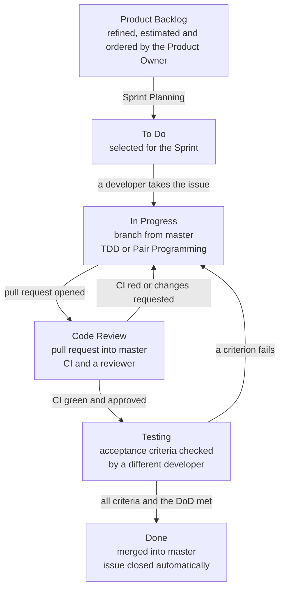

# DietNow – Development Workflow

How one User Story moves from the Product Backlog to Done. Each User Story is a GitHub issue (for example #17 for US-10) and a card on the team's GitHub Projects board.

## Diagram



## The states

| State | Who acts | What happens | Leaves when | Where you see it |
|---|---|---|---|---|
| **Product Backlog** | Product Owner, with the whole team | The story is refined (INVEST, acceptance criteria), estimated with Planning Poker and ordered. | It is selected at Sprint Planning. | `docs/PRODUCT_BACKLOG.md`, the issue |
| **To Do** | the team | The story is in the Sprint Backlog, not started. | A developer assigns the issue to themselves. | board |
| **In Progress** | the developer (or a pair) | Branch `feat/us-NN-short-name` from `master`. Code and tests, either with TDD (red, green, refactor commits) or with Pair Programming. | The work meets the acceptance criteria locally and a pull request is opened. | board, branch, commits |
| **Code Review** | a reviewer (another developer) and CI | The reviewer reads the diff. CI runs on the pull request: backend `gofmt`, `go vet`, build, unit and PostgreSQL integration tests; frontend lint, typecheck, tests, build; the release Docker image and a smoke test. | CI is green and the reviewer approves. Otherwise back to In Progress. | pull request, Checks tab |
| **Testing** | a developer who did not write the story | Runs the app and checks every acceptance criterion of the issue and the Definition of Done. | All pass. If one fails, back to In Progress. | pull request comment, board |
| **Done** | the Product Owner or any developer | The pull request is merged into `master`; `Closes #N` closes the issue. CI runs again on `master`, and a green `master` deploys to staging. | — | board, closed issue, `master` |

## Rules

**One issue, one branch, one pull request.** The branch starts from the current `master` and the pull request targets `master`. The description starts with `Closes #N`, so merging closes the issue.

Why only `master`: #41 targeted another feature branch. When that branch was merged first, #41 stayed pointed at it, so US-08 landed in the wrong branch, #15 stayed open, and the work had to be opened again as #43.

**Branch names:** `feat/us-NN-short-name` for a User Story, `fix/short-name` for a bug, `docs/short-name` for documentation.

**Commit messages show the TDD cycle.** For a story built with TDD:

```
test(frontend): specify removing a logged entry (US-10, red)
feat(frontend): remove a logged entry from the tracker (US-10, green)
refactor(frontend): use errorMessage for tracker load errors (US-10)
```

A red commit adds a test that fails; the next green commit makes it pass. Running the tests on each commit proves the cycle.

**Review and acceptance by someone else.** The author never approves their own pull request or checks their own acceptance criteria.

**Merge with "Create a merge commit", not "Squash and merge".** Squashing turns all of a story's commits into one, which erases the red and green commits from `master`'s history. Keep feature branches until the final presentation; they are the evidence for TDD.

**Move the card at every step**, so the board shows the Sprint's real progress.
